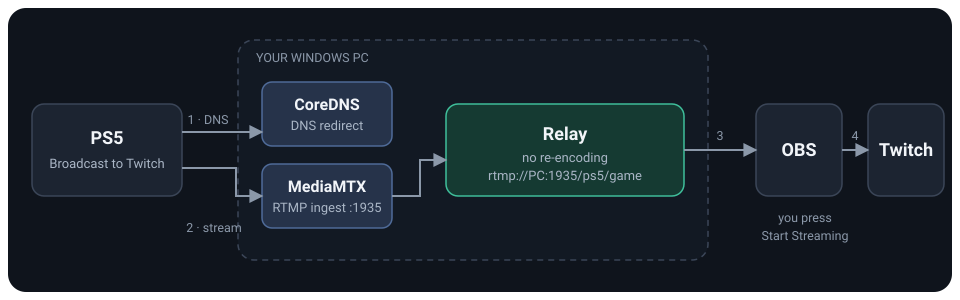
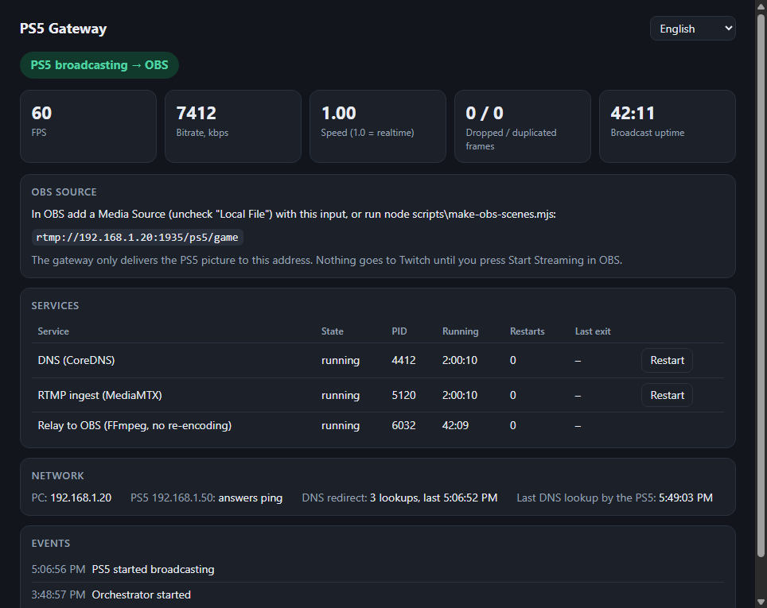

<div align="center">

# PS5 Gateway

**Your PS5's picture in OBS. No capture card.**

Redirect the PS5's built-in Twitch broadcast to your Windows PC, open it in OBS as a normal source, and stream from there with your own scenes, overlays and alerts.


[Quick start](#quick-start) · [Install guide](docs/INSTALL.md) · [Install with AI](docs/AI-INSTALL.md) · [Troubleshooting](docs/TROUBLESHOOTING.md) · [Русский](README.ru.md)

<br>



</div>

<br>

## The problem

The PS5 can broadcast to Twitch by itself, but that is all it does. No overlays, no alerts, no scenes, no way to touch the picture. The usual fix is a capture card and an HDMI splitter.

## The idea

When the PS5 starts a broadcast it looks up a Twitch ingest address. PS5 Gateway answers that lookup with your PC. The stream lands on your PC instead of Twitch, and OBS picks it up from a fixed local address.

|   |   |
|---|---|
| **No hardware** | The PS5 sends its stream over your home network. No capture card, no splitter. |
| **Real OBS** | Scenes, filters, chat, StreamElements, Streamlabs, DonationAlerts, recording. Everything OBS does. |
| **You stay in control** | The gateway never sends anything to Twitch. Nothing is public until you press **Start Streaming** in OBS. |
| **PS5 still shows chat** | The console talks to Twitch as usual, so chat and the viewer count still appear on the PS5. |
| **Easy to set up** | One setup script, one `doctor` command that tells you what is wrong, and a ready OBS scene. |

## Quick start

You need Windows 10 or 11, [Node.js 24 LTS](https://nodejs.org), [OBS Studio](https://obsproject.com), and a PS5 on the same network as the PC.

```powershell
git clone https://github.com/avedevelop/ps5-gateway.git
cd ps5-gateway

node scripts\setup.mjs --ps5-ip=192.168.1.50                    # downloads FFmpeg, MediaMTX, CoreDNS; writes .env
powershell -ExecutionPolicy Bypass -File scripts\firewall.ps1   # run once, in an Administrator PowerShell
powershell -ExecutionPolicy Bypass -File scripts\start.ps1      # start the gateway
node scripts\doctor.mjs                                         # checks every link of the chain
node scripts\make-obs-scenes.mjs                                # creates the "PS5" scene in OBS
```

Then:

1. **On the PS5** set the DNS of your network connection to the PC's address (setup prints it).
2. **On the PS5** open Broadcast, choose Twitch and go live.
3. **In OBS** pick the **PS5** scene collection, enter your stream key under Settings > Stream, and press **Start Streaming** when you are ready.

Full walkthrough with every menu path: **[docs/INSTALL.md](docs/INSTALL.md)**. Prefer to have an AI do the talking? Copy a prompt from **[docs/AI-INSTALL.md](docs/AI-INSTALL.md)**.

## Dashboard

A small local dashboard at `http://127.0.0.1:8787` shows whether the PS5 is broadcasting, relay health, and restart buttons for the services. It speaks English, Russian, Ukrainian, German and Spanish.

<div align="center">

<br>
<sub>Illustrative state with placeholder addresses.</sub>
</div>

## What is included

- **Setup** with pinned, checksum-verified downloads and automatic LAN address detection.
- **`doctor`** that checks files, addresses, name-resolution speed, the DNS redirect, the RTMP port and the PS5's activity, and prints a fix for every problem it finds.
- **Dashboard** with live relay stats and service restarts.
- **OBS scene generator** that writes a `PS5` collection with one scene, the PS5 source already fitted to the canvas and set to reconnect by itself.
- **Firewall script** that opens DNS and RTMP for the PS5 only.
- **Optional autostart** with Windows.
- No npm dependencies. The whole thing runs on Node's built-ins.

## Requirements

- Windows 10 or 11, 64-bit. The scripts use Windows firewall rules and PowerShell.
- Node.js 22.18 or newer (24 LTS recommended).
- OBS Studio.
- A PS5 and a PC on the same local network. Give the PC a fixed address in your router (DHCP reservation), because the PS5 is told to use it as its DNS server.

## Good to know

- **Tested on one setup** (Windows 11, PS5, OBS 32). Other hardware should work but has not been tried.
- **Quality** is bounded by the stream the PS5 produces plus OBS's own encode. [Troubleshooting](docs/TROUBLESHOOTING.md) lists the OBS settings that help.
- **DNS is the PS5's lifeline while this runs.** If the gateway is stopped, the PS5 has no internet until you set its DNS back to Automatic. The install guide explains how.
- This is a hobby project, offered as is. Read [SECURITY.md](SECURITY.md) before exposing anything beyond your home network.

## Is this allowed?

The gateway only changes how **your own** console reaches **your own** PC on **your own** network. It does not touch Sony's or Twitch's servers, does not break encryption and does not bypass any protection. You still stream through your own Twitch account under Twitch's Terms of Service, and the game you play has its own rules about streaming. Do not point other people's devices at your DNS server.

This project is not affiliated with, endorsed by, or connected to Sony Interactive Entertainment, Twitch, OBS Project or any other company named here. All names are trademarks of their owners.

## Documentation

| | |
|---|---|
| [Install guide](docs/INSTALL.md) | Step by step, including the PS5 menus |
| [Install with AI](docs/AI-INSTALL.md) | Ready prompts for an AI assistant or coding agent |
| [Architecture](docs/ARCHITECTURE.md) | How it works, ports, files |
| [Troubleshooting](docs/TROUBLESHOOTING.md) | Black screen, no internet on the PS5, slow DNS, quality |
| [Contributing](CONTRIBUTING.md) | Development and tests |

## License

[PolyForm Noncommercial 1.0.0](LICENSE). Free for personal and other non-commercial use, not for commercial use. This is a source-available license, not an OSI "open source" one. Software that setup downloads keeps its own license, listed in [NOTICE.md](NOTICE.md).
