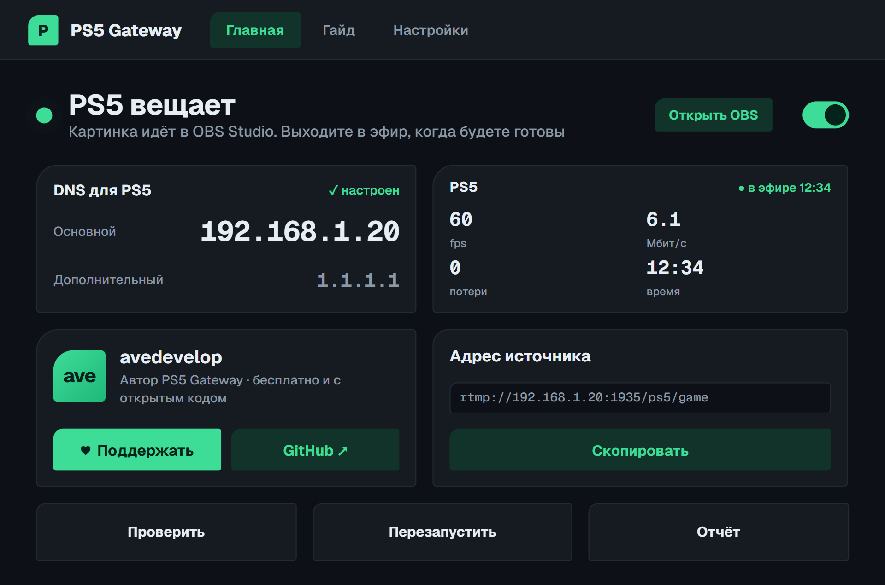

# PS5 Gateway

Картинка с PS5 в **OBS** по домашней сети, без карты захвата, а дальше стрим на Twitch из OBS.

У PS5 есть встроенная трансляция на Twitch, но без оверлеев, алертов и сцен. PS5 Gateway незаметно перенаправляет эту трансляцию на ваш ПК с Windows или Mac. OBS открывает её как обычный Media Source, и дальше всё как в обычном OBS: сцены, оверлеи, чат, StreamElements, Streamlabs, DonationAlerts, запись, фильтры.

> English version: [README.md](README.md) · Пошагово с картинками: **[гайд для Windows](docs/WINDOWS.ru.md)** · **[гайд для macOS](docs/MACOS.ru.md)**

```
PS5 «Трансляция» ──DNS-подмена──▶ ваш ПК
                                   ├─ CoreDNS     отвечает PS5 адресом ПК вместо сервера Twitch
                                   ├─ MediaMTX    принимает поток PS5 (порт 1935)
                                   └─ Оркестратор держит их запущенными, пересылает поток, показывает панель
                                            │
                                            ▼
                    rtmp://<ПК>:1935/ps5/game ──▶ OBS (Media Source) ──▶ Twitch
                                                  (вы нажимаете «Начать трансляцию»)
```

Шлюз сам ничего не отправляет на Twitch. Пока OBS не запущен в эфир, ничего не публично.

## Быстрый старт

**Проще всего через приложение.** Скачайте архив для своей системы, распакуйте, откройте приложение и пройдите установку. Каждый шаг с картинкой есть в гайде для вашей системы:

| | Гайд | Что скачать |
|---|---|---|
| <br>**Windows 10 / 11** | **[Гайд для Windows](docs/WINDOWS.ru.md)** | `ps5-gateway-windows-<версия>.zip` |
| <br>**macOS** (Apple silicon или Intel) | **[Гайд для macOS](docs/MACOS.ru.md)** | `ps5-gateway-macos-<версия>.tar.gz` |

Оба архива лежат на странице [последнего релиза](https://github.com/avedevelop/ps5-gateway/releases/latest). Хотите скрипт или командную строку? Читайте дальше.

### Установщик в один клик

Скачайте архив для своей системы со [страницы последнего релиза](https://github.com/avedevelop/ps5-gateway/releases/latest), распакуйте и запустите установщик. Он проверит Node.js, FFmpeg и OBS, скачает вспомогательные программы, создаст настройки, запустит шлюз, прогонит `doctor` и создаст сцену OBS. Адрес PS5 он спросит сам, а перед каждым шагом, который меняет систему, попросит разрешения.

| | Что скачать | Что запустить |
|---|---|---|
| **Windows 10 / 11** | `ps5-gateway-windows-<версия>.zip` | двойной щелчок по `PS5 Gateway.exe` (приложение) или по `installer\windows\Install-PS5-Gateway.cmd` (установщик-скрипт) |
| **macOS** (Apple silicon или Intel) | `ps5-gateway-macos-<версия>.tar.gz` | двойной щелчок по `installer/macos/Install PS5 Gateway.command` (в первый раз: правый клик → «Открыть») |

Хотите видеть каждый шаг? Команды ниже.

### По шагам

Нужны Windows 10/11 **или** macOS, [Node.js 24 LTS](https://nodejs.org), [OBS Studio](https://obsproject.com) и PS5 в той же сети, что и компьютер.

**Windows**

```powershell
git clone https://github.com/avedevelop/ps5-gateway.git
cd ps5-gateway
node scripts\setup.mjs --ps5-ip=192.168.1.50      # скачает FFmpeg, MediaMTX, CoreDNS, создаст .env
powershell -ExecutionPolicy Bypass -File scripts\firewall.ps1   # PowerShell от администратора, один раз
powershell -ExecutionPolicy Bypass -File scripts\start.ps1
node scripts\doctor.mjs                           # проверит всю цепочку
node scripts\make-obs-scenes.mjs <IP ПК> --lang=ru   # коллекция сцен «PS5» в OBS
```

**macOS** (Apple silicon или Intel; FFmpeg ставится через [Homebrew](https://brew.sh))

```bash
git clone https://github.com/avedevelop/ps5-gateway.git
cd ps5-gateway
brew install ffmpeg
node scripts/setup.mjs --ps5-ip=192.168.1.50      # скачает MediaMTX и CoreDNS, создаст .env
sh scripts/start.sh                               # права администратора не нужны
node scripts/doctor.mjs                           # проверит всю цепочку
node scripts/make-obs-scenes.mjs <IP Mac> --lang=ru   # коллекция сцен «PS5» в OBS
```

Дальше на PS5 укажите DNS вашего подключения: адрес ПК (его покажет setup), запустите «Трансляцию» и выберите Twitch. В OBS выберите коллекцию **PS5**, введите ключ трансляции в Настройки → Трансляция и нажмите «Начать трансляцию», когда будете готовы.

Подробная установка по шагам: [docs/INSTALL.md](docs/INSTALL.md) (на английском). Установка с помощью ИИ: [docs/AI-INSTALL.md](docs/AI-INSTALL.md).

## Приложение для компьютера

В архивах релиза лежит небольшое приложение поверх шлюза: **PS5 Gateway.exe** для Windows и **PS5 Gateway.app** для macOS. В нём пошаговая установка с настоящим прогрессом загрузки, панель со статусом PS5, настройки (в том числе расширенные), встроенная помощь по частым проблемам, отчёт для диагностики, который можно отдать ИИ-ассистенту (или сохранить в файл), и обновления из релизов GitHub. Язык интерфейса: русский, английский, украинский, немецкий, испанский.

<div align="center">

</div>

- **По шагам с картинками:** [гайд для Windows](docs/WINDOWS.ru.md) · [гайд для macOS](docs/MACOS.ru.md).
- **Держите рядом со `scripts/`:** приложение работает с папкой проекта, в которой лежит. Не выносите его из неё.
- **Живёт в фоне.** Закрытие окна только прячет его: приложение остаётся в области уведомлений (Windows) или в строке меню (macOS), а шлюз продолжает работать. Пункт *Выйти* в этом меню закрывает приложение. Выключение шлюза это отдельный шаг с подтверждением.
- **Windows один раз спросит разрешение** во время установки (шаг с брандмауэром), чтобы шлюз был доступен только вашей PS5.
- **Подписи пока нет.** Windows SmartScreen покажет «Подробнее > Выполнить в любом случае», на macOS в первый раз нужен правый клик > Открыть. Как именно, показано в гайдах.
- **Обновления:** Настройки > Обновления проверяют последний релиз (обращение только к GitHub, ничего о вас не отправляется) и заменяют файлы на месте. Ваши настройки, загрузки и журналы сохраняются.
- **Собрать самому:** `scripts\build-app.ps1` на Windows или `sh scripts/build-app.sh` на Mac, нужен [Rust](https://rustup.rs). Для разработки: `sh app/dev.sh` (macOS). Картинки в документации делает `node tools/screenshots.mjs`.

Прежняя веб-панель по-прежнему доступна на `http://127.0.0.1:8787`.

## Что внутри

- PS5 по-прежнему сама показывает чат и зрителей: берёт их прямо с Twitch.

- Установка без ручной работы: загрузки с проверкой контрольных сумм, автоопределение IP ПК, генерация конфигов.
- `doctor`: проверяет файлы, адреса, скорость DNS на ПК, подмену DNS, порт RTMP и активность PS5, и пишет, как исправить.
- Панель `http://127.0.0.1:8787` (на 5 языках): вещает ли PS5, состояние пересылки, кнопки перезапуска сервисов, адрес источника для OBS.
- Установщики в один клик для Windows и macOS. CI на каждое изменение ставит шлюз на чистые Windows и macOS, отправляет тестовый поток и проверяет, что он приходит на адрес, который читает OBS.
- На macOS скрипт файрвола не нужен: шлюз сам отвечает только PS5 и вашему Mac. Пока PS5 вещает, компьютер (Windows и macOS) не уходит в сон по бездействию.
- Автозапуск при входе в систему без окна (задача планировщика в Windows, LaunchAgent в macOS).
- Если PS5 отвечает на пинг, но шлюз не спрашивает, приложение предупреждает и подсказывает перезагрузить консоль.
- Генератор сцен OBS: одна сцена «PS5» с источником PS5, уже растянутым на весь экран; источник сам переподключается.

## Ограничения

- Проверено с настоящей PS5 на: Windows 10 и 11 (OBS 32) и MacBook с Apple silicon на macOS 27 (OBS 33.0.1). Остальное должно работать, но не проверялось; отчёты приветствуются.
- На macOS нужен OBS 33 или новее: OBS 32.2.2 на macOS 27 падает при запуске (см. [docs/TROUBLESHOOTING.md](docs/TROUBLESHOOTING.md#macos)).
- MacBook засыпает при закрытой крышке, и шлюз останавливается вместе с ним: во время стрима держите крышку открытой.
- DNS это то, как PS5 находит шлюз. В гайдах дополнительный DNS ставится `1.1.1.1`, поэтому консоль обычно сохраняет интернет, пока шлюз выключен. Но консоль, которая перешла на дополнительный DNS, может **остаться на нём** и после возвращения шлюза, и тогда её трансляция уйдёт сразу на Twitch. **После смены DNS на PS5 или выключения шлюза перезагружайте PS5 полностью (не режим покоя).** Приложение предупредит, если консоль не обращается к шлюзу. Чтобы перестать пользоваться шлюзом, верните DNS на PS5 в «Автоматически».
- OBS заново кодирует картинку, поэтому качество ограничено потоком самой PS5. Подсказки по настройкам: [docs/TROUBLESHOOTING.md](docs/TROUBLESHOOTING.md).
- Проект не связан с Sony, Twitch и другими упомянутыми компаниями. Он меняет только то, как ваша консоль находит ваш ПК в вашей сети.

## Лицензия

[MIT](LICENSE): можно свободно использовать, копировать, изменять и распространять, в том числе в коммерческих целях. Версии 1.0.0 и 1.1.0 вышли под PolyForm Noncommercial 1.0.0 и остаются под ней для уже опубликованных копий; последующие версии под MIT. Загружаемое стороннее ПО сохраняет свои лицензии, см. [NOTICE.md](NOTICE.md).
