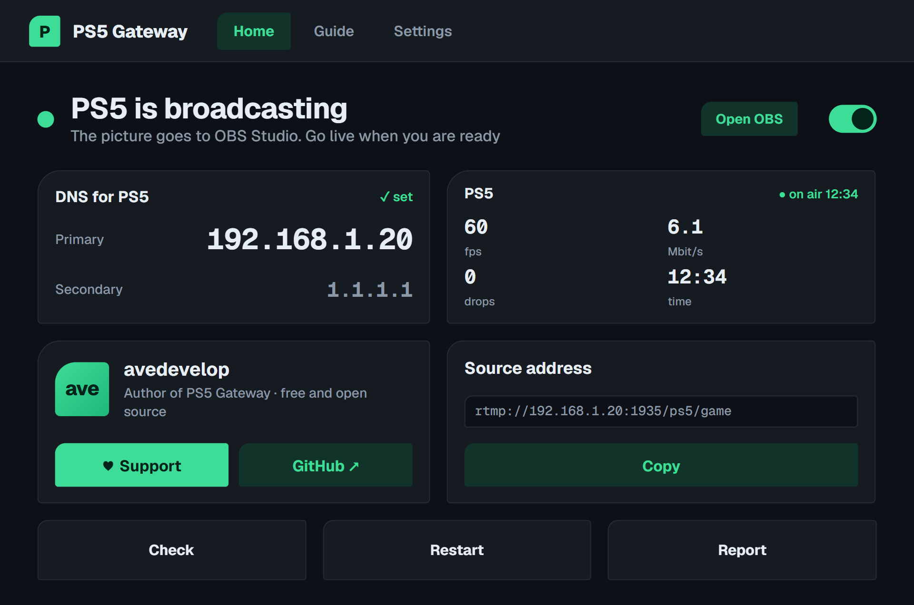
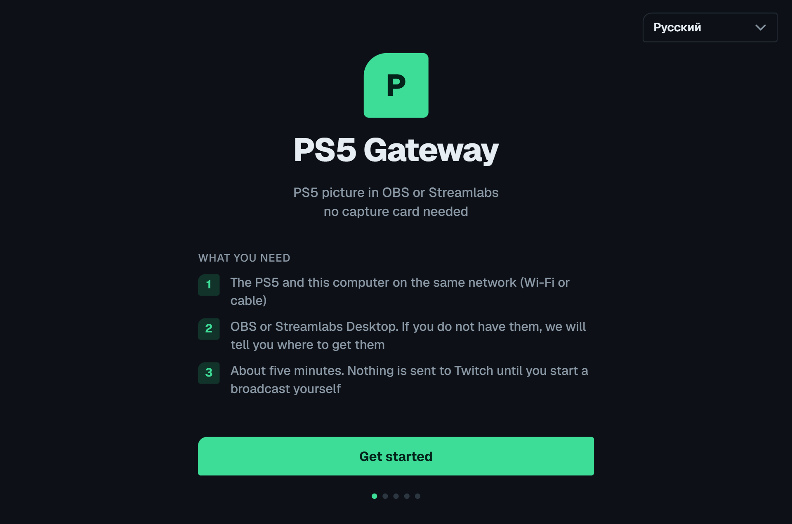
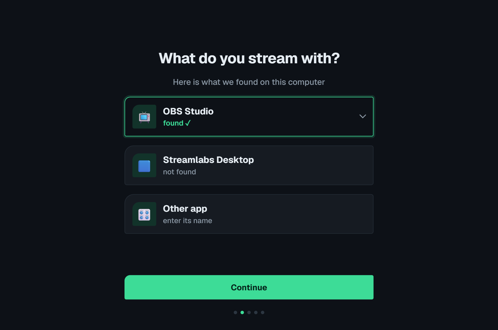
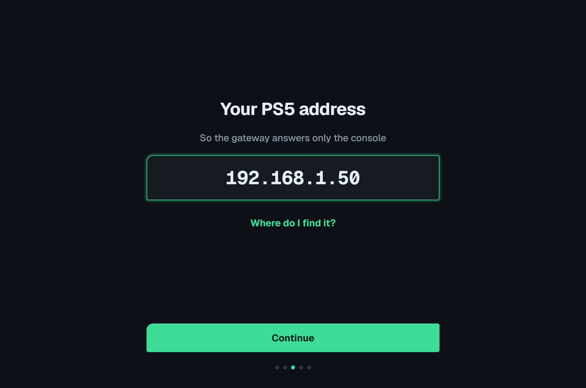
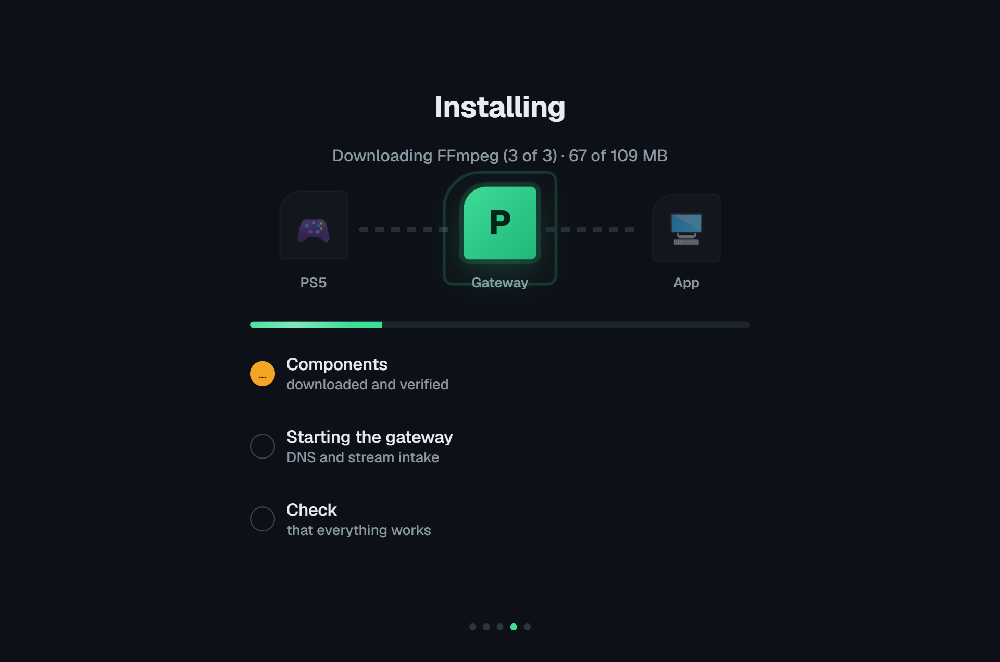
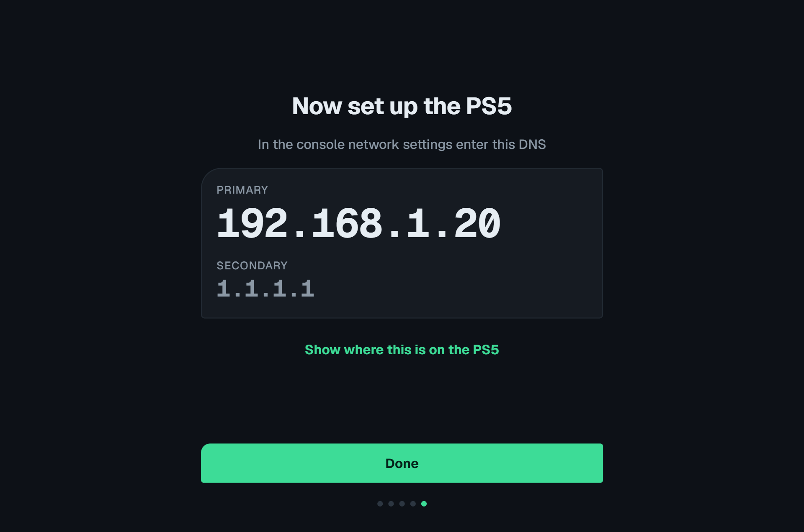
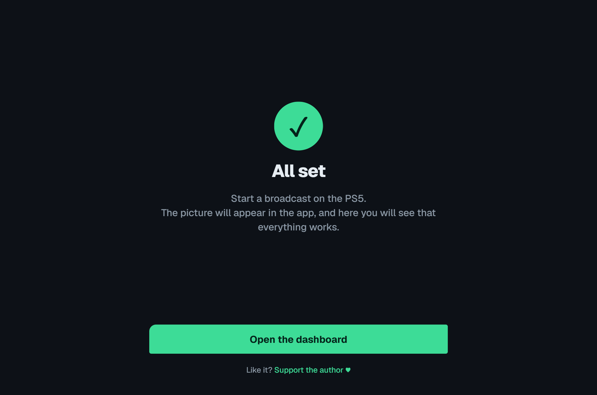
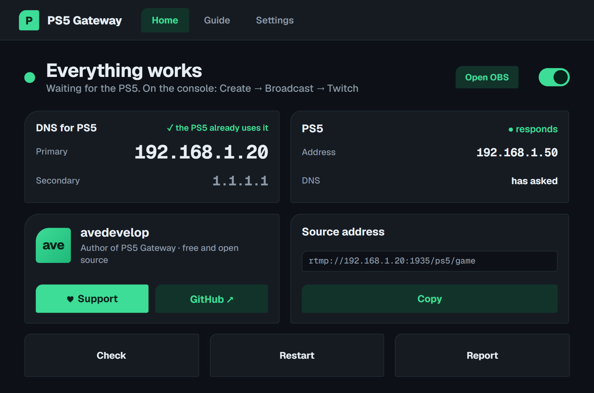
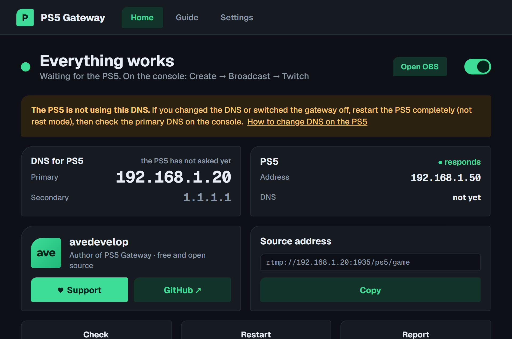
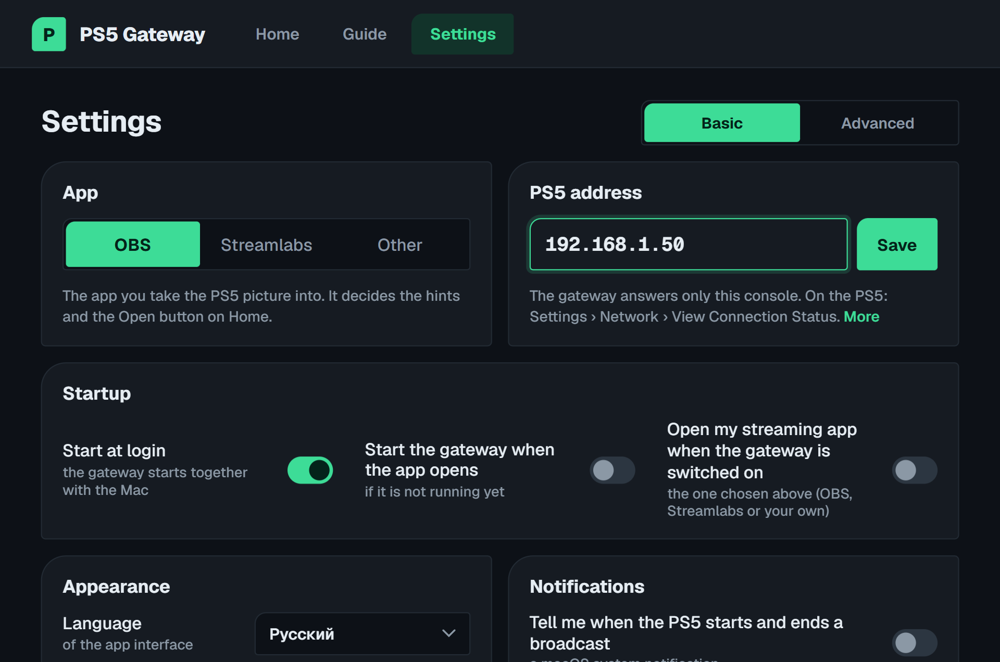

# PS5 Gateway on macOS

**From download to the first broadcast in about five minutes.**

[Русский](MACOS.ru.md) · [Windows guide](WINDOWS.md) · [Troubleshooting](TROUBLESHOOTING.md#macos) · [Back to the README](../README.md)

The pictures in this guide use made-up addresses (192.168.1.x). Yours will differ. They show the interface itself; the window frame is your Mac's.

 

## What you need

- A Mac with Apple silicon or Intel.
- [Node.js 24 LTS](https://nodejs.org). The gateway runs on it.
- [Homebrew](https://brew.sh) and **FFmpeg** from it: `brew install ffmpeg` (macOS has no official FFmpeg build to download).
- [OBS Studio](https://obsproject.com) **33 or newer** (OBS 32.2.2 crashes at startup on macOS 27, see [Troubleshooting](TROUBLESHOOTING.md#macos)) or Streamlabs Desktop.
- A PS5 on the same home network as the Mac (cable or Wi-Fi).

## 1. Download and open

1. Open the [latest release](https://github.com/avedevelop/ps5-gateway/releases/latest) and download **`ps5-gateway-macos-<version>.tar.gz`**.
2. Unpack it into a folder you keep, for example `~/ps5-gateway`. **Not** into Desktop, Documents or Downloads: macOS does not let background programs read those without asking.
3. Right-click **PS5 Gateway.app** › **Open**. This is needed the first time only, because the app is not signed with an Apple developer certificate.

> **macOS says the app is damaged or cannot be opened.** Open Terminal in that folder and run `xattr -dr com.apple.quarantine .` once, then open the app again.
>
> Keep the app **next to the `scripts` folder**: it works with the project folder it sits in. Do not move the `.app` out of it.

## 2. Guided setup

Pick your language in the corner first, if you like: the app speaks English, Russian, Ukrainian, German and Spanish.

<table>
<tr>
<td width="50%"> <b>1. Welcome.</b> Press <i>Get started</i>.</td>
<td width="50%"> <b>2. Your program.</b> The app shows what it found on the Mac. Choose OBS or Streamlabs.</td>
</tr>
<tr>
<td> <b>3. PS5 address.</b> On the PS5: Settings › Network › View Connection Status › IPv4 address. Type it here.</td>
<td> <b>4. Installing.</b> Real download progress. There is no firewall step on a Mac: the gateway answers only your PS5 and this Mac.</td>
</tr>
<tr>
<td> <b>5. DNS for the PS5.</b> The two numbers are typed on the console by hand (next section).</td>
<td> <b>6. All set.</b> The gateway is running.</td>
</tr>
</table>

If macOS shows its firewall question for CoreDNS or MediaMTX, choose **Allow**.

## 3. Tell the PS5 to use the gateway

On the PS5:

1. **Settings › Network › Settings › Set Up Internet Connection.**
2. Choose your network, then **Advanced Settings › DNS Settings › Manual**.
3. **Primary DNS:** the big number from the app (this Mac's address). **Secondary DNS:** `1.1.1.1`.
4. **Done**, then **Test Internet Connection**.
5. **Turn the PS5 fully off and on again** (not rest mode). This matters: a console that was using another DNS can stay on it, and then its broadcast goes straight to Twitch and never reaches OBS.

## 4. Broadcast

1. On the PS5 press **Create › Broadcast › Twitch** and go live.
2. The app changes to **PS5 is broadcasting** and shows frames per second, megabits and the time.
3. In OBS pick the scene collection **PS5** (the app creates it), enter your stream key under *Settings › Stream* and press **Start Streaming** when you are ready. Nothing is public until you do.

<table>
<tr>
<td width="50%"> <b>Waiting.</b> Everything runs, the gateway waits for the PS5.</td>
<td width="50%"> <b>On air.</b> The picture is on its way to OBS. Copy the source address from the card if OBS asks for it.</td>
</tr>
</table>

## 5. Every day

- **Closing the window does not stop the gateway.** The app stays in the menu bar (click the icon to open it, *Quit* to leave). To switch the gateway off, use the switch on the Home screen. It asks first, because the broadcast to OBS stops.
- **Start at login:** Settings › Basic › Startup › *Start at login* (a LaunchAgent).
- **The Mac stays awake during a broadcast** (Settings › Advanced › Power). **A MacBook still sleeps when the lid is closed**, and the gateway stops with it: keep the lid open, or use an external display and power.
- **Updates:** Settings › Updates checks GitHub (nothing about you is sent) and replaces the files in place. Your settings and downloads stay.
- **Uninstall:** Settings › Advanced › *Uninstall…* lists what it deletes. Then set the PS5's DNS back to *Automatic*.

## If something does not work

<table>
<tr>
<td width="50%"> <b>"The PS5 is not using this DNS".</b> The console answers pings but never asks the gateway. Restart the PS5 completely and check its primary DNS.</td>
<td width="50%"> <b>Settings.</b> Basic and Advanced: address, startup, notifications, DNS, power, report, updates.</td>
</tr>
</table>

- **The PS5 broadcast goes straight to Twitch, not to OBS.** Restart the PS5 completely (step 3.5). If your router has IPv6 on, try turning it off.
- **The PS5 says it cannot start the broadcast.** Link your Twitch account: Settings › Users and Accounts › Link with Other Services.
- **FFmpeg is missing.** Run `brew install ffmpeg`, then press *Try again* in the app.
- **Report for help.** *Report* on Home creates a report you can hand to an AI assistant or the author. It hides network addresses by default, never includes your stream key, and nothing is sent anywhere by itself. **Save to a file** puts it on your Desktop.
- More cases: [Troubleshooting](TROUBLESHOOTING.md) and *Guide › If something does not work* inside the app.

## Prefer the command line?

Everything the app does is a script in `scripts/`. See the [install guide](INSTALL.md).
