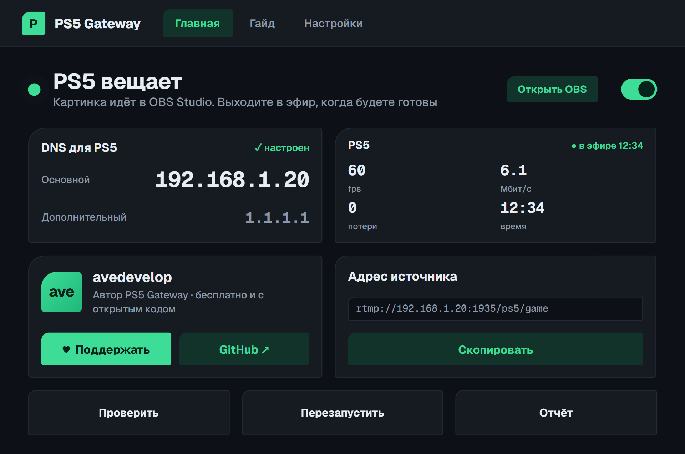
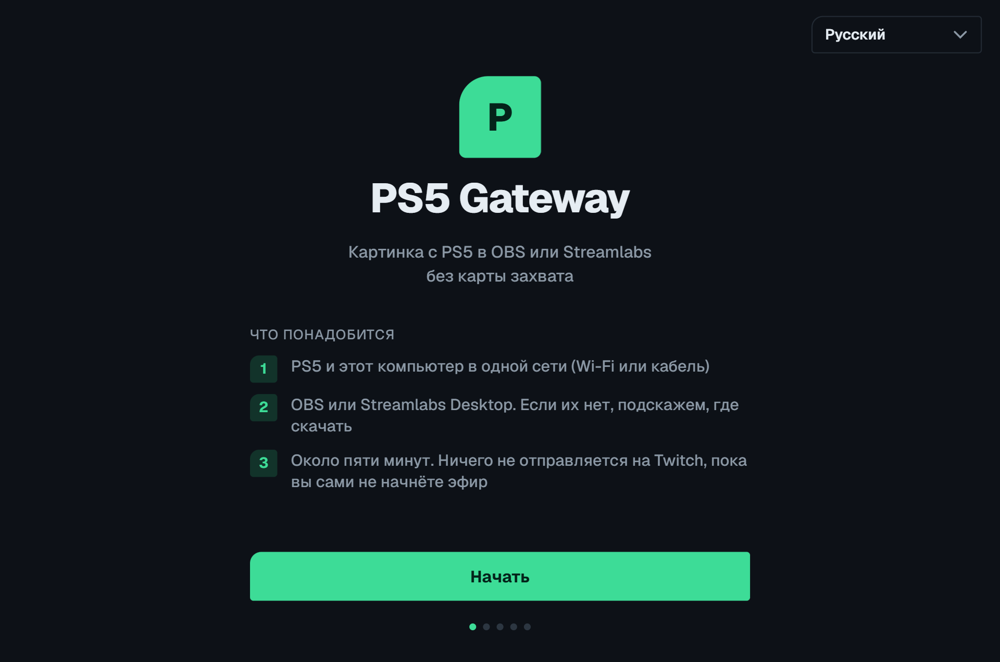
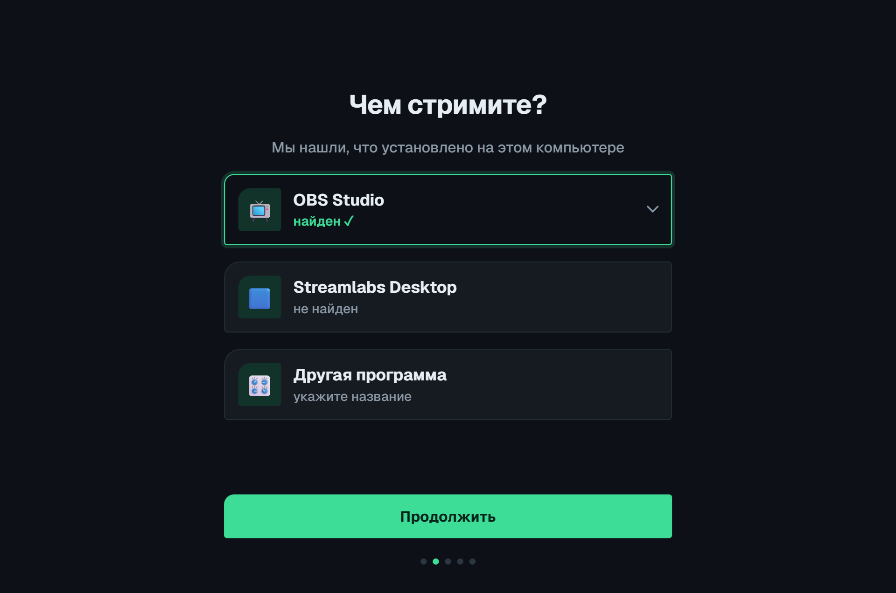
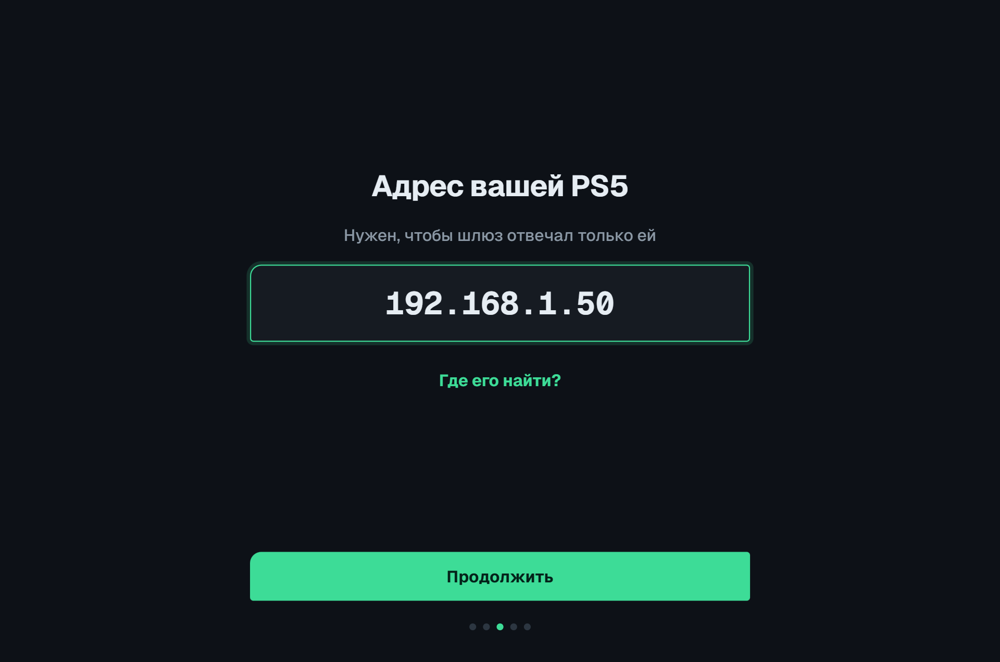
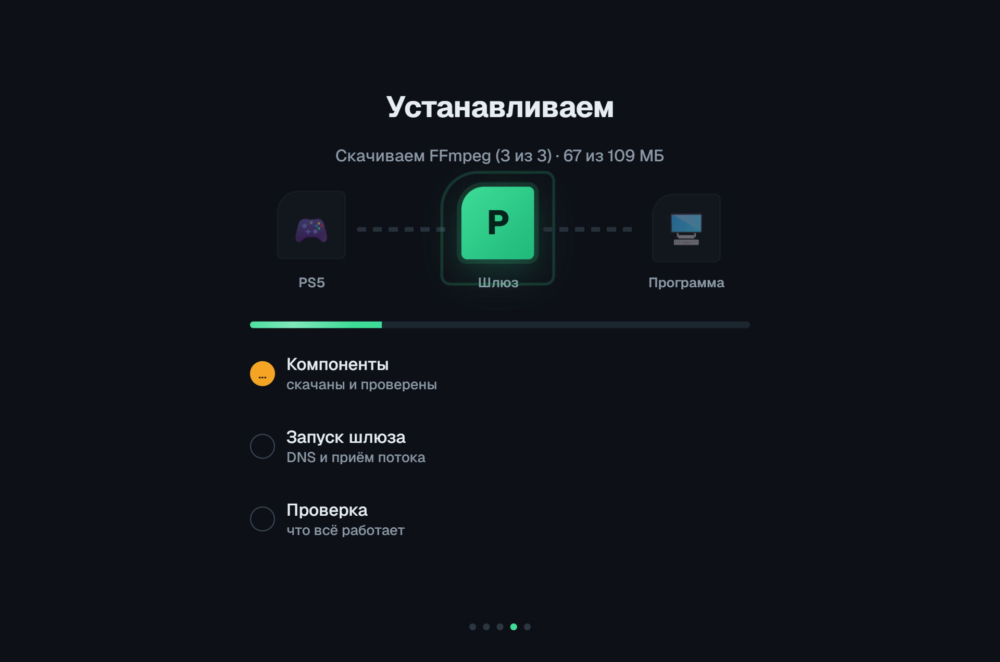
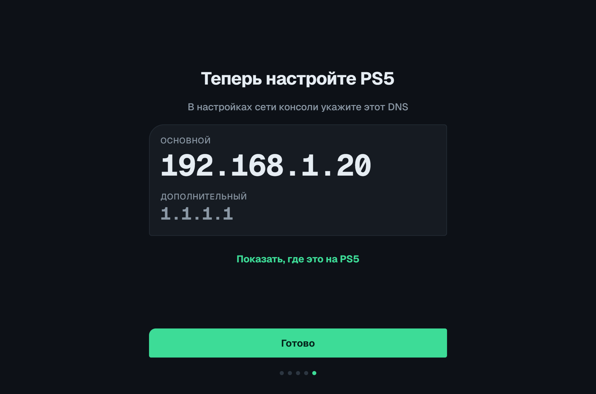
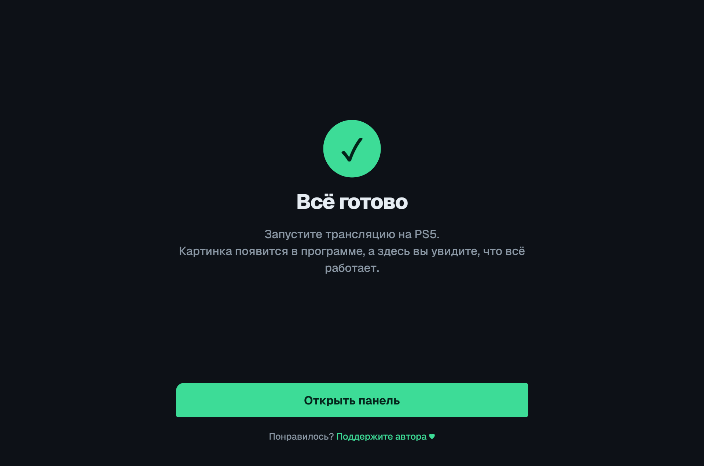
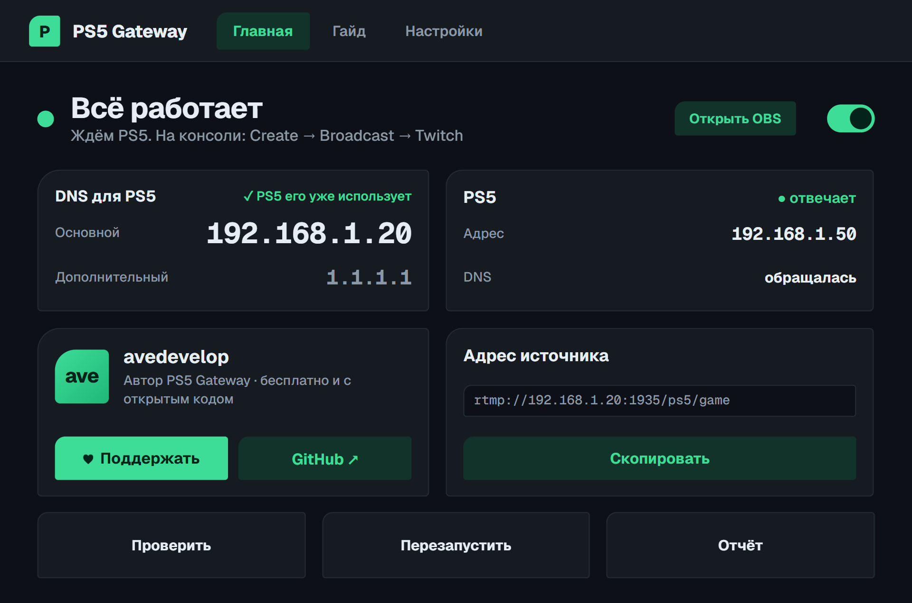
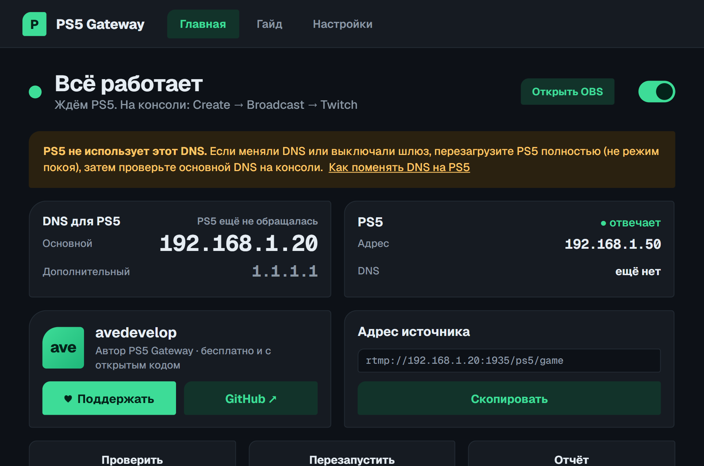
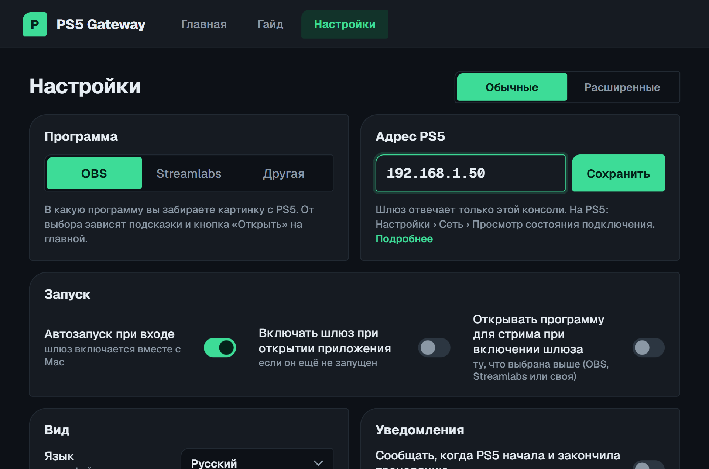

# PS5 Gateway на macOS

**От скачивания до первой трансляции примерно за пять минут.**

[English](MACOS.md) · [Гайд для Windows](WINDOWS.ru.md) · [Если что-то не работает](TROUBLESHOOTING.md#macos) · [Назад к README](../README.ru.md)

На картинках выдуманные адреса (192.168.1.x). У вас будут другие. Это сам интерфейс; рамка окна ваша, от macOS.

 

## Что понадобится

- Mac на Apple silicon или Intel.
- [Node.js 24 LTS](https://nodejs.org). На нём работает шлюз.
- [Homebrew](https://brew.sh) и **FFmpeg** из него: `brew install ffmpeg` (официальной сборки FFmpeg для macOS нет).
- [OBS Studio](https://obsproject.com) **версии 33 или новее** (OBS 32.2.2 падает при запуске на macOS 27, см. [Troubleshooting](TROUBLESHOOTING.md#macos)) или Streamlabs Desktop.
- PS5 в той же домашней сети, что и Mac (кабель или Wi-Fi).

## 1. Скачайте и откройте

1. Откройте [последний релиз](https://github.com/avedevelop/ps5-gateway/releases/latest) и скачайте **`ps5-gateway-macos-<версия>.tar.gz`**.
2. Распакуйте в постоянную папку, например `~/ps5-gateway`. **Не** на рабочий стол, не в «Документы» и не в «Загрузки»: фоновым программам macOS не даёт читать их без вопроса.
3. Дважды щёлкните **PS5 Gateway.app**. В первый раз macOS откажет: у приложения пока нет сертификата разработчика Apple (см. рамку ниже). Это нужно сделать один раз.

> **«PS5 Gateway» не открыт. Apple не удалось проверить, что в нём нет вредоносного ПО.** Это обычный ответ macOS на приложение не из App Store, и в этом окне нет кнопки *Открыть*. Сделайте так:
>
> 1. Нажмите **Готово** (не *Переместить в Корзину*).
> 2. Откройте **Системные настройки › Конфиденциальность и безопасность** и прокрутите вниз до раздела *Безопасность*. Там написано, что **«PS5 Gateway» заблокировано для защиты вашего Mac**.
> 3. Нажмите **Всё равно открыть**, подтвердите паролем или Touch ID и ещё раз **Всё равно открыть**.
>
> На macOS 14 и старше работает быстрый способ: правый клик по приложению › **Открыть**. Если удобнее Терминал, одна команда делает то же на любой версии: `xattr -dr com.apple.quarantine "PS5 Gateway.app"` (выполните её в папке с приложением).

> **macOS пишет, что приложение повреждено.** Откройте Терминал в этой папке, один раз выполните `xattr -dr com.apple.quarantine .` и откройте приложение снова.
>
> Держите приложение **рядом с папкой `scripts`**: оно работает с папкой проекта, в которой лежит. Не выносите `.app` из неё.

## 2. Установка с подсказками

Язык можно выбрать в углу: есть русский, английский, украинский, немецкий и испанский.

<table>
<tr>
<td width="50%"> <b>1. Приветствие.</b> Нажмите <i>Начать</i>.</td>
<td width="50%"> <b>2. Ваша программа.</b> Приложение показывает, что нашло на Mac. Выберите OBS или Streamlabs.</td>
</tr>
<tr>
<td> <b>3. Адрес PS5.</b> На PS5: Settings › Network › View Connection Status › адрес IPv4. Впишите его.</td>
<td> <b>4. Установка.</b> Настоящий прогресс загрузки. Шага с брандмауэром на Mac нет: шлюз отвечает только вашей PS5 и этому Mac.</td>
</tr>
<tr>
<td> <b>5. DNS для PS5.</b> Два числа вводятся на консоли вручную (следующий раздел).</td>
<td> <b>6. Всё готово.</b> Шлюз запущен.</td>
</tr>
</table>

Если macOS спросит про брандмауэр для CoreDNS или MediaMTX, выберите **Разрешить**.

## 3. Скажите PS5 пользоваться шлюзом

На PS5:

1. **Settings › Network › Settings › Set Up Internet Connection.**
2. Выберите свою сеть, затем **Advanced Settings › DNS Settings › Manual**.
3. **Primary DNS:** большое число из приложения (адрес этого Mac). **Secondary DNS:** `1.1.1.1`.
4. **Done**, затем **Test Internet Connection**.
5. **Выключите PS5 полностью и включите снова** (не режим покоя). Это важно: консоль, которая сидела на другом DNS, может на нём остаться, и тогда её трансляция уйдёт сразу на Twitch, а не в OBS.

## 4. Трансляция

1. На PS5: **Create › Broadcast › Twitch**, начните трансляцию.
2. Приложение покажет **PS5 вещает** с кадрами в секунду, мегабитами и временем.
3. В OBS выберите коллекцию сцен **PS5** (её создаёт приложение), впишите ключ трансляции в *Настройки › Трансляция* и нажмите **Начать трансляцию**, когда будете готовы. Пока вы не нажали, на Twitch ничего не уходит.

<table>
<tr>
<td width="50%"> <b>Ожидание.</b> Всё работает, шлюз ждёт PS5.</td>
<td width="50%"> <b>В эфире.</b> Картинка идёт в OBS. Если OBS просит адрес источника, скопируйте его из карточки.</td>
</tr>
</table>

## 5. Каждый день

- **Закрытие окна не останавливает шлюз.** Приложение остаётся в строке меню (щёлкните значок, чтобы открыть; *Выйти*, чтобы закрыть). Чтобы выключить шлюз, используйте переключатель на главном экране. Он спросит подтверждение: трансляция в OBS остановится.
- **Запуск при входе:** Настройки › Обычные › Запуск › *Автозапуск при входе* (LaunchAgent).
- **Mac не засыпает во время трансляции** (Настройки › Расширенные › Питание). **MacBook всё равно засыпает при закрытой крышке**, и шлюз останавливается вместе с ним: держите крышку открытой или используйте внешний монитор и питание.
- **Обновления:** Настройки › Обновления проверяют GitHub (о вас ничего не отправляется) и заменяют файлы на месте. Настройки и загрузки сохраняются.
- **Удаление:** Настройки › Расширенные › *Удалить…* покажет, что будет удалено. Потом верните DNS на PS5 в *Автоматически*.

## Если что-то не работает

<table>
<tr>
<td width="50%"> <b>«PS5 не использует этот DNS».</b> Консоль отвечает на пинг, но шлюз она не спрашивает. Перезагрузите PS5 полностью и проверьте основной DNS.</td>
<td width="50%"> <b>Настройки.</b> Обычные и Расширенные: адрес, запуск, уведомления, DNS, питание, отчёт, обновления.</td>
</tr>
</table>

- **Трансляция с PS5 идёт сразу на Twitch, а не в OBS.** Перезагрузите PS5 полностью (шаг 3.5). Если на роутере включён IPv6, попробуйте его отключить.
- **PS5 пишет, что не может начать трансляцию.** Привяжите аккаунт Twitch: Settings › Users and Accounts › Link with Other Services.
- **Нет FFmpeg.** Выполните `brew install ffmpeg`, затем нажмите *Попробовать снова* в приложении.
- **Отчёт для помощи.** Кнопка *Отчёт* на главной собирает отчёт, который можно отдать ИИ-ассистенту или автору. Адреса сети в нём скрыты по умолчанию, ключ трансляции не попадает никогда, сам по себе ничего не отправляется. **Сохранить в файл** кладёт его на рабочий стол.
- Другие случаи: [Troubleshooting](TROUBLESHOOTING.md) и *Гайд › Если что-то не работает* в приложении.

## Любите командную строку?

Всё, что делает приложение, это скрипты в `scripts/`. См. [руководство по установке](INSTALL.md).
