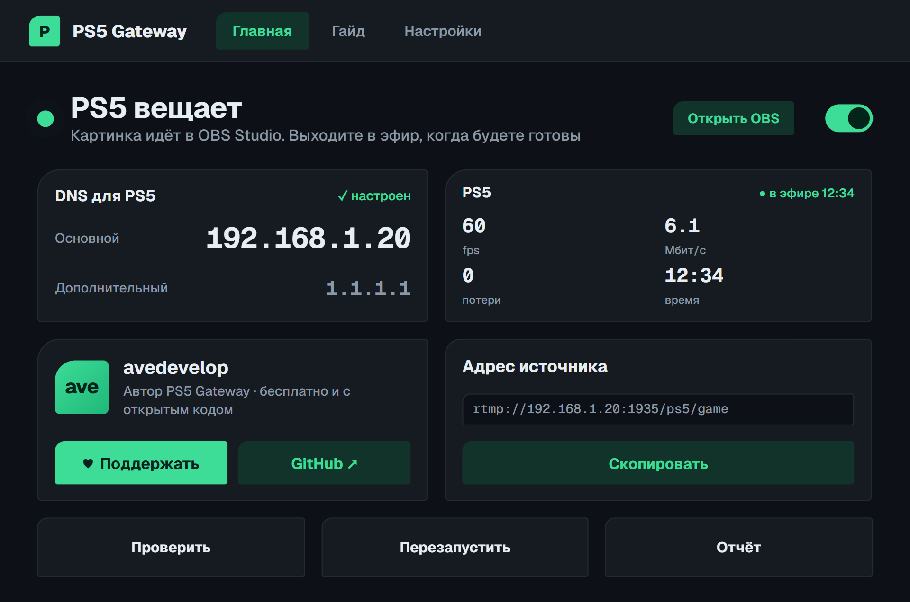
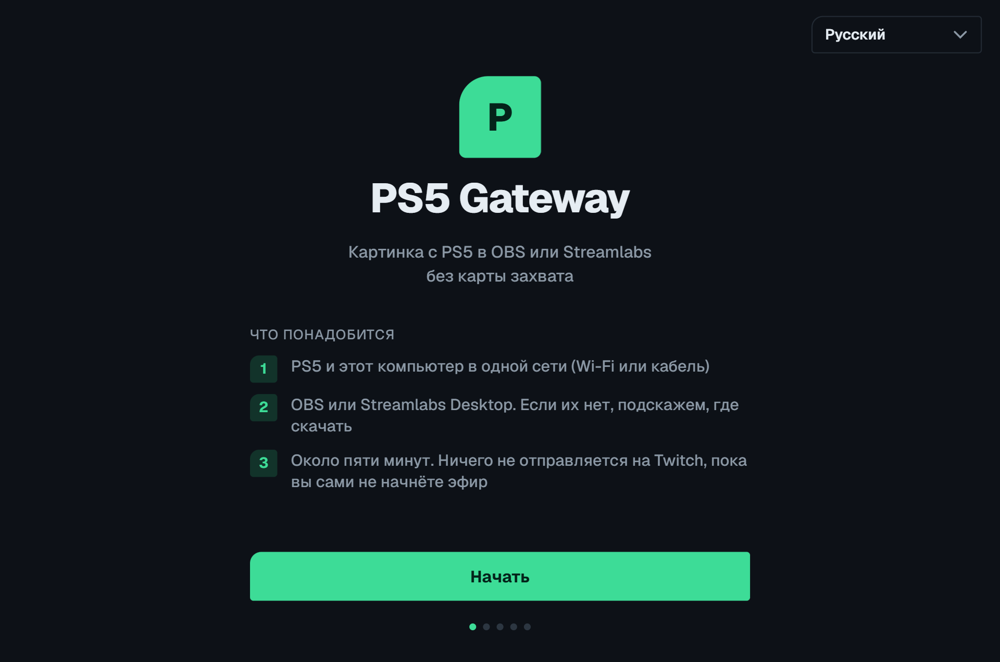
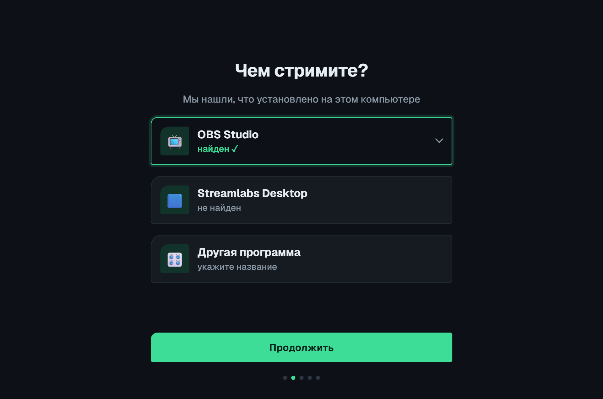
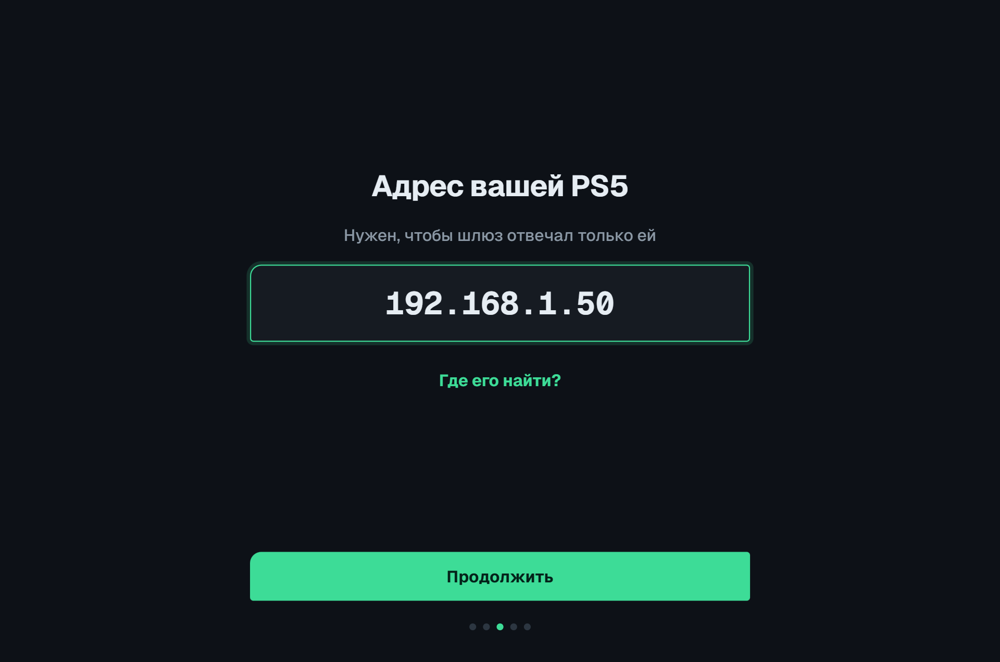
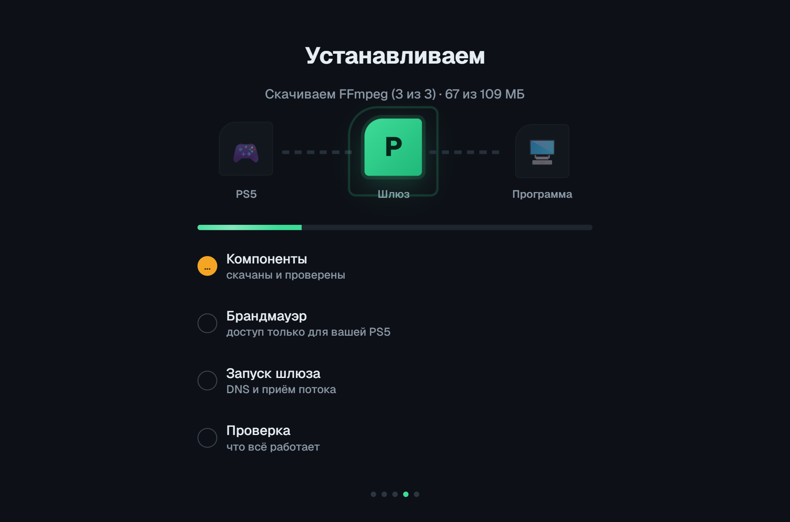
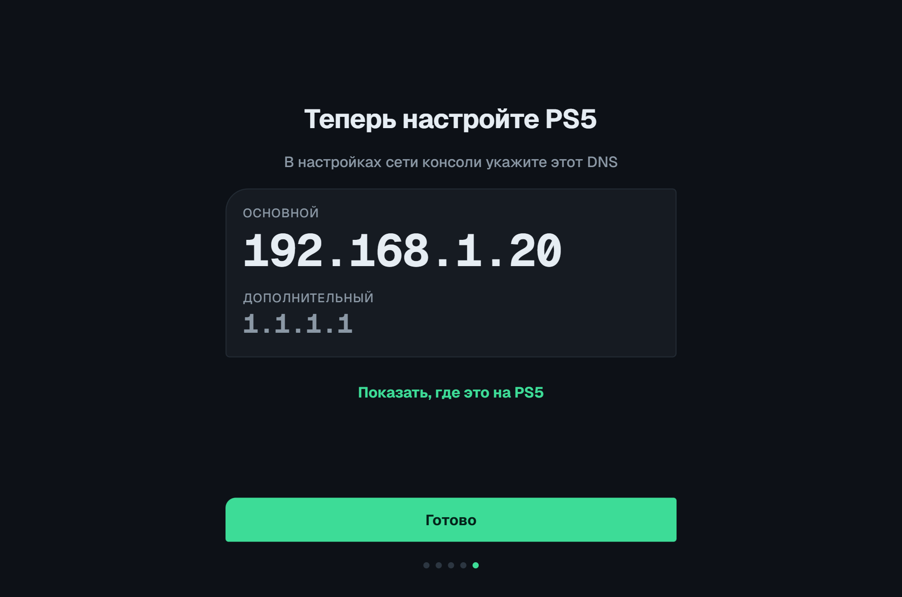
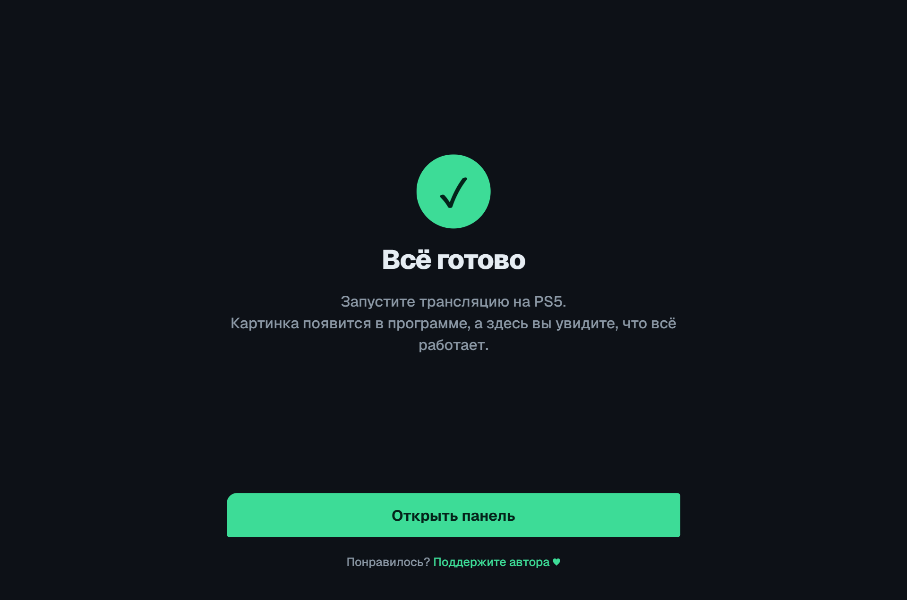
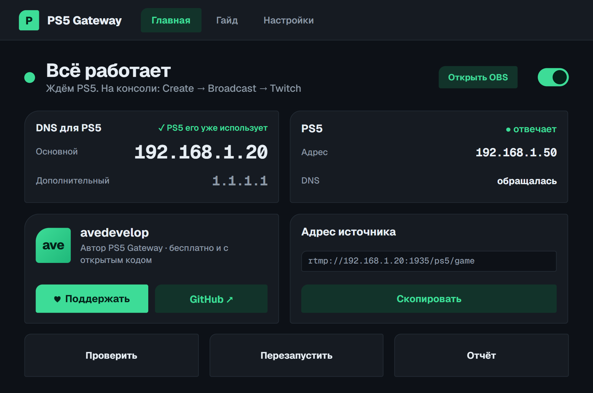
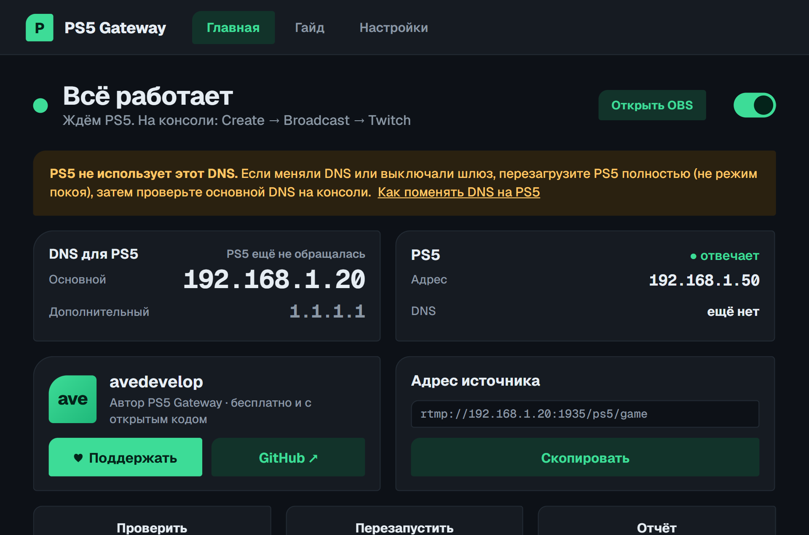
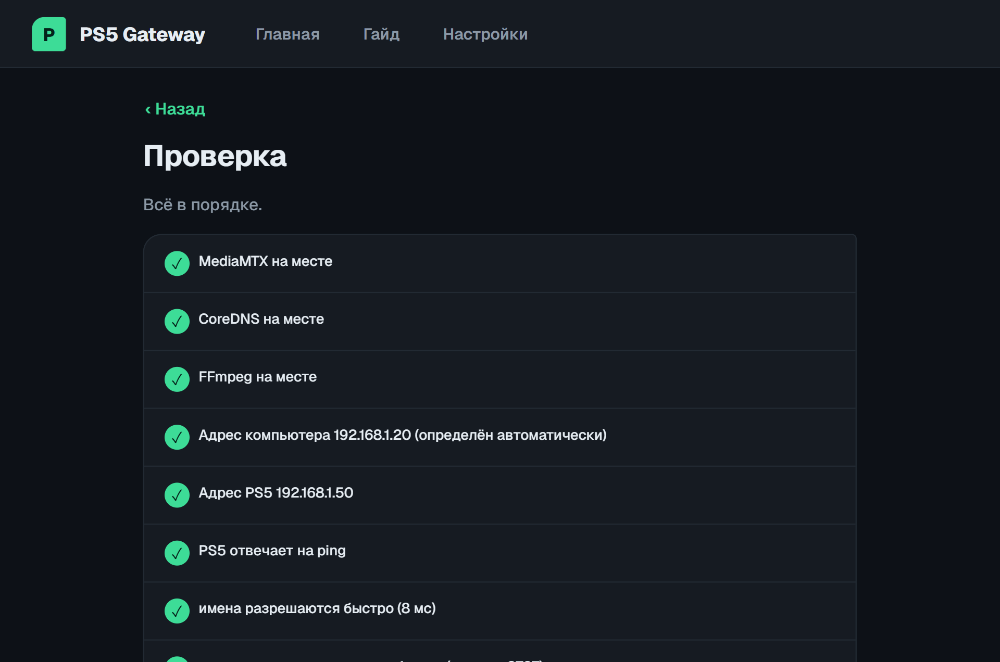

# PS5 Gateway на Windows

**От скачивания до первой трансляции примерно за пять минут.**

[English](WINDOWS.md) · [Гайд для macOS](MACOS.ru.md) · [Если что-то не работает](TROUBLESHOOTING.md) · [Назад к README](../README.ru.md)

На картинках выдуманные адреса (192.168.1.x). У вас будут другие.

 

## Что понадобится

- Windows 10 или 11, 64 бита. WebView2, который нужен приложению, есть в обеих.
- [Node.js 24 LTS](https://nodejs.org). На нём работает шлюз. Поставьте его заранее, настройки по умолчанию (около минуты).
- [OBS Studio](https://obsproject.com) или Streamlabs Desktop. OBS из Steam тоже находится.
- PS5 в той же домашней сети, что и компьютер (кабель или Wi-Fi).
- Около 250 МБ свободного места. Приложение скачивает вспомогательные программы (MediaMTX, CoreDNS, FFmpeg), проверяет их контрольные суммы и хранит в своей папке.

## 1. Скачайте и распакуйте

1. Откройте [последний релиз](https://github.com/avedevelop/ps5-gateway/releases/latest) и скачайте **`ps5-gateway-windows-<версия>.zip`**.
2. Распакуйте в постоянную папку, например `C:\ps5-gateway`. Не в `Program Files` и не в папку, которая синхронизируется с облаком.
3. Откройте папку и дважды щёлкните **`PS5 Gateway.exe`**.

> **Windows пишет «Система Windows защитила ваш компьютер».** У приложения пока нет платного сертификата подписи. Нажмите **Подробнее**, затем **Выполнить в любом случае**. Весь код открыт в этом репозитории, а каждая загрузка сверяется с контрольной суммой из `SHA256SUMS.txt`.

## 2. Установка с подсказками

Приложение открывается с короткой установкой. Язык можно выбрать в углу: есть русский, английский, украинский, немецкий и испанский.

<table>
<tr>
<td width="50%"> <b>1. Приветствие.</b> Нажмите <i>Начать</i>.</td>
<td width="50%"> <b>2. Ваша программа.</b> Приложение показывает, что нашло на компьютере. Выберите OBS или Streamlabs.</td>
</tr>
<tr>
<td> <b>3. Адрес PS5.</b> На PS5: Settings › Network › View Connection Status › адрес IPv4. Впишите его.</td>
<td> <b>4. Установка.</b> Настоящий прогресс загрузки. <b>Windows один раз спросит разрешение</b> (шаг с брандмауэром): выберите <i>Да</i>. Оно открывает DNS и порт потока только для вашей PS5.</td>
</tr>
<tr>
<td> <b>5. DNS для PS5.</b> Два числа вводятся на консоли вручную (следующий раздел).</td>
<td> <b>6. Всё готово.</b> Шлюз запущен.</td>
</tr>
</table>

## 3. Скажите PS5 пользоваться шлюзом

На PS5:

1. **Settings › Network › Settings › Set Up Internet Connection.**
2. Выберите свою сеть, затем **Advanced Settings › DNS Settings › Manual**.
3. **Primary DNS:** большое число из приложения (адрес этого компьютера). **Secondary DNS:** `1.1.1.1`.
4. **Done**, затем **Test Internet Connection**.
5. **Выключите PS5 полностью и включите снова** (не режим покоя). Это важно: консоль, которая сидела на другом DNS, может на нём остаться, и тогда её трансляция уйдёт сразу на Twitch, а не в OBS.

## 4. Трансляция

1. На PS5: **Create › Broadcast › Twitch**, начните трансляцию.
2. Приложение покажет **PS5 вещает** с кадрами в секунду, мегабитами и временем.
3. В OBS нужна сцена с PS5 как источником. Быстрее всего: в папке приложения один раз выполните `node scripts\make-obs-scenes.mjs <PC address>` (OBS должен быть хотя бы раз запущен), перезапустите OBS и выберите коллекцию сцен **PS5**. Само приложение её не создаёт. Вручную: *Гайд › Настроить OBS* в приложении показывает шаги (источник мультимедиа с адресом с карточки на главном экране, «Локальный файл» выключен). Затем впишите ключ трансляции в *Настройки › Трансляция* и нажмите **Начать трансляцию**, когда будете готовы. Пока вы не нажали, на Twitch ничего не уходит.

<table>
<tr>
<td width="50%"> <b>Ожидание.</b> Всё работает, шлюз ждёт PS5.</td>
<td width="50%"> <b>В эфире.</b> Картинка идёт в OBS. Если OBS просит адрес источника, скопируйте его из карточки.</td>
</tr>
</table>

## 5. Каждый день

- **Закрытие окна не останавливает шлюз.** Приложение остаётся в области уведомлений у часов (щёлкните значок, чтобы открыть; правая кнопка → *Выйти*). Чтобы выключить шлюз, используйте переключатель на главном экране. Он спросит подтверждение: трансляция в OBS остановится.
- **Запуск вместе с Windows:** Настройки › Обычные › Запуск › *Автозапуск при входе*. Шлюз включается при входе в систему, без окна.
- **Компьютер не засыпает во время трансляции** (Настройки › Расширенные › Питание). Выключите, если не нужно.
- **Обновления:** Настройки › Обновления проверяют GitHub (о вас ничего не отправляется) и заменяют файлы на месте. Настройки и загрузки сохраняются.
- **Удаление:** Настройки › Расширенные › *Удалить…* покажет, что будет удалено. Потом верните DNS на PS5 в *Автоматически*.

## Если что-то не работает

<table>
<tr>
<td width="50%"> <b>«PS5 не использует этот DNS».</b> Консоль отвечает на пинг, но шлюз она не спрашивает. Перезагрузите PS5 полностью и проверьте основной DNS.</td>
<td width="50%"> <b>Проверка.</b> Нажмите <i>Проверить</i> на главной: каждая строка говорит, что в порядке, а если нет, то как исправить.</td>
</tr>
</table>

- **Трансляция с PS5 идёт сразу на Twitch, а не в OBS.** Перезагрузите PS5 полностью (шаг 3.5). Если на роутере включён IPv6, попробуйте его отключить.
- **PS5 пишет, что не может начать трансляцию.** Привяжите аккаунт Twitch: Settings › Users and Accounts › Link with Other Services.
- **Отчёт для помощи.** Кнопка *Отчёт* на главной собирает отчёт, который можно отдать ИИ-ассистенту или автору. Адреса сети в нём скрыты по умолчанию, ключ трансляции не попадает никогда, сам по себе ничего не отправляется. **Сохранить в файл** кладёт его на рабочий стол.
- Другие случаи: [Troubleshooting](TROUBLESHOOTING.md) и *Гайд › Если что-то не работает* в приложении.

## Любите командную строку?

Всё, что делает приложение, это скрипты в `scripts\`. См. [руководство по установке](INSTALL.md).
